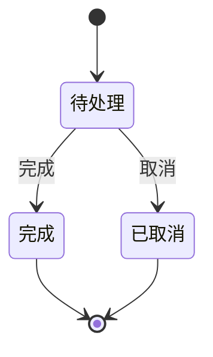
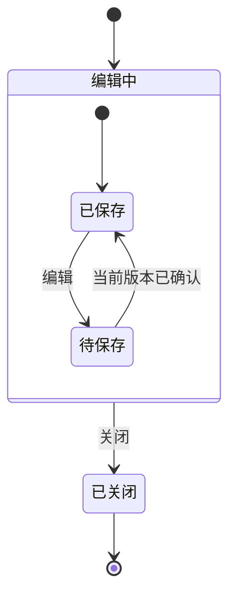
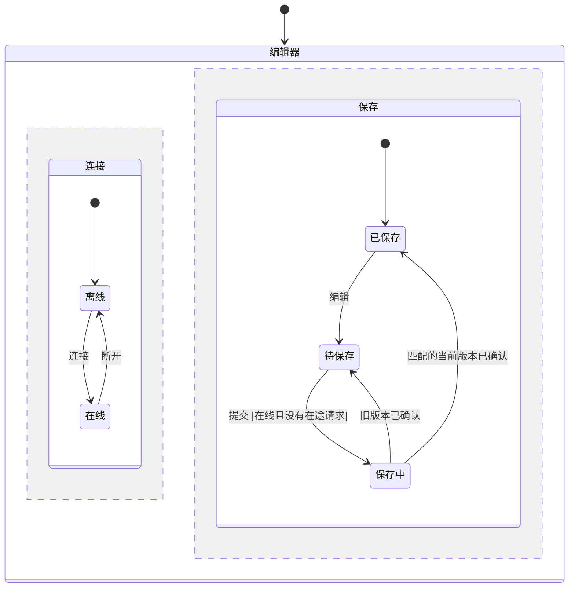

# 呈现行为

制作或解释状态图时读取。状态和事件使用读者的语言。保留 Mermaid 文本作为可编辑图源。

## 说明视图

注明图是人工组织的模型摘要、检查器导出可达状态的投影，还是一条具体反例路径。连接到模型及检查记录。在图旁说明初始条件和相关数据。

为每个标签或标记定义它代表的状态谓词及性质状态。为重要箭头指出动作和守卫。分开说明绘图范围及模型检查的探索范围。

## 绘制平面流程

这个构造的生命周期从待处理开始。按选定规则，完成和取消都是终态。

Done 中重复的 `finish` 被忽略，Cancelled 中的 `finish` 被拒绝。图省略这些同状态响应。结束标记表达读者所理解的生命周期终点。检查器模型通过自己的受守卫动作表达合法终态行为。

## 绘制层级

这份人工组织的编辑器摘要采用[建模](./modeling.md)中的进入和退出约定。

按本构造约定，进入 Editing 选择 Clean。从任一子状态关闭时，退出该子状态及 Editing，再释放本地订阅。视图省略请求身份及保存中间状态。判断旧确认时使用完整的版本模型。历史和框架特定的进入顺序需要在模型旁给出目标系统语义。

## 绘制并行区域

连接和保存状态同时活动。此图概括一个构造的编辑器协议，初态为 Offline 和 Unchanged。

Unchanged 表示当前版本已确认，Changed 表示留有待保存内容。断开作为共享事件投递。连接区域进入 Offline。保存区域保留当前活动状态及在途请求。迟到确认继续按身份和版本处理。提交要求箭头上注明的联合条件。按本构造约定，这些效果组成一个宏步。

图省略 Saving 期间的编辑、同状态响应及父状态退出行为。完整模型需要保留其中影响问题的路径。Online 和 Saving 的联合配置不同于 Offline 和 Saving，保存区域标签在两者中相同。依赖该组合的性质在图旁说明。采用框架的事件选择或并行区域语义前，读取[建模](./modeling.md)。

## 保留投影区别

定义从模型数据到图标签的投影。假设“已保存”节点同时代表：

- `current = 1`、`acknowledged = 1`、`saved = TRUE`，满足 `SavedTruth`。
- `current = 2`、`acknowledged = 1`、`saved = TRUE`，违反 `SavedTruth`。

注明它包含两种结果，列出两个谓词，或拆成读者能理解的“当前版本已保存”和“错误显示已保存”。标记适用于全部底层状态和部分底层状态时含义不同。注明受影响性质；并行视图还需要指出违反性质的联合区域配置。

投影边表示存在至少一个对应转移。连续的投影边可能来自不兼容的底层状态。声称一条路径可执行时，根据同一条具体模型状态序列核对。小图可以展示相关子图和完整反例，检查记录保留完整搜索范围。

## 讲清反例

保留检查器的实际状态编号、动作名、关键变量和首次违反位置。在面向读者的路径旁提供相应值。以下是保存示例的设计推演，实际 TLC 轨迹另行绑定：

1. 编辑到版本 1，确认版本仍为 0，没有在途请求。
2. 提交版本 1，将它保留为在途请求。
3. 请求仍在途时，编辑到版本 2。
4. 确认版本 1。错误变体显示已保存，此时当前版本为 2，确认版本为 1。

首次违反 `SavedTruth` 的位置是该确认到达后的状态。正确变体保持待保存，后续可以提交并确认版本 2。检查器轨迹包含初态及其自身编号，运行报告使用实际编号。

活性失败保留前缀、循环或持续停顿后缀、始终未满足的进展条件，以及缺失或被违反的公平性假设。一条以待保存结束的有限路径，需要补充无限延续才能解释最终发生性质的违反。

省略自环、重置边、重复箭头、数据或不可达组合会影响解释时，将它们列出。完成标准：读者能判断行为，定位决定性模型状态，并按路径复现推演。
