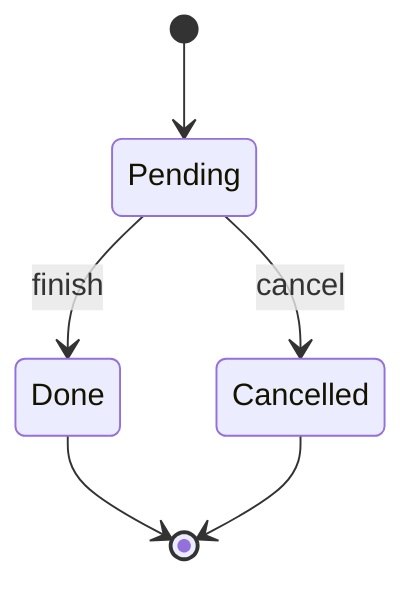
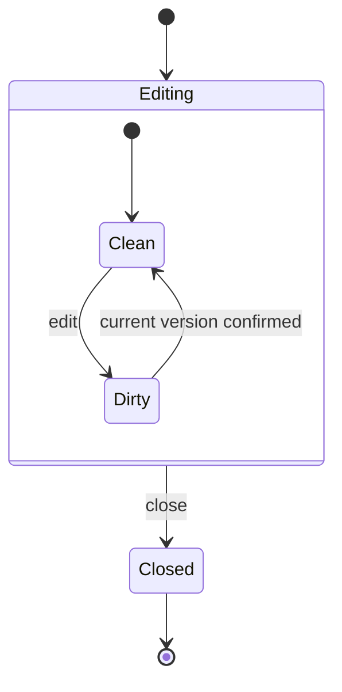
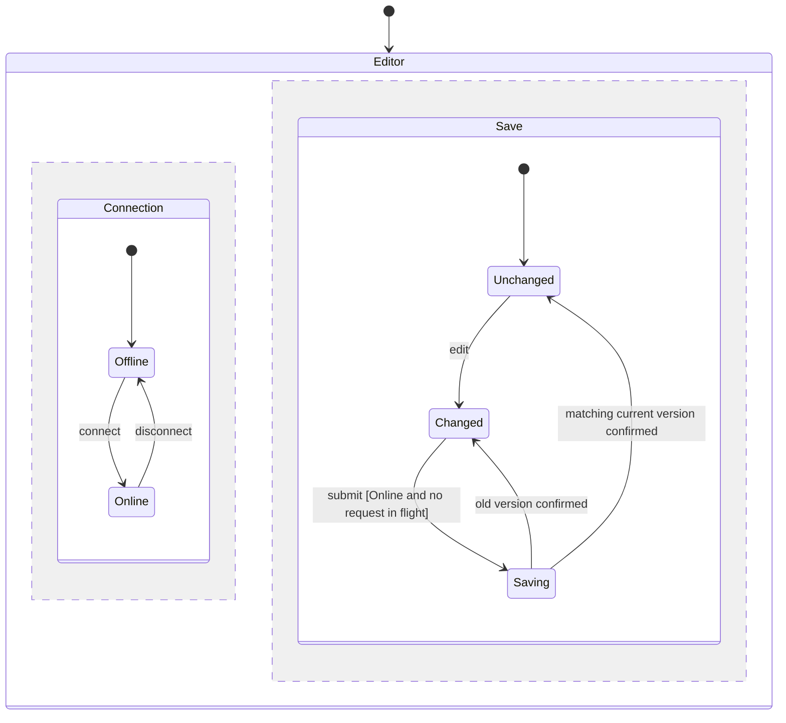

# Show behavior

Read this when making or interpreting a state diagram. Use the reader's language for states and events. Keep Mermaid text as editable diagram source.

## Name the view

Identify the diagram as a manually organized model summary, a projection of checker-exported reachable states, or one concrete counterexample path. Link it to its model and check record. Give the initial condition and relevant data beside the view.

For each label or mark, define the represented state predicate and any property status. For each important arrow, identify the action and guard. Distinguish the graph's drawn scope from the model check's explored scope.

## Draw a flat flow

This constructed lifecycle starts pending. Finishing and cancellation are terminal under its chosen rules.

Repeated `finish` in Done is ignored; `finish` in Cancelled is rejected. The drawing omits those same-state responses. The final markers express the reader's lifecycle end. A checker model separately represents legal terminal behavior using its own guarded action.

## Draw hierarchy

This manually organized editor summary uses the entry and exit convention described in [Modeling](./modeling.md).

Entering Editing selects Clean in this constructed convention. Closing from either child exits the child and Editing, then releases the local subscription. This view omits request identity and intermediate save states. Use the full versioned model when judging an old confirmation. History and framework-specific entry ordering require the chosen system's semantics beside the model.

## Draw parallel regions

Connection and save status are simultaneously active. This diagram summarizes a constructed editor protocol, with initial state Offline and Unchanged.

Unchanged means the current version is confirmed; Changed means pending content. Disconnect is delivered as a shared event. The connection region enters Offline. The save region retains its active state and in-flight request. A late confirmation is still processed by identity and version. Submit requires the joint condition shown on its arrow. These effects form one macrostep in this constructed convention.

The drawing omits edits during Saving, same-state responses, and parent exit behavior. The full model must retain any of those paths relevant to the question. The joint configuration Online and Saving is distinct from Offline and Saving even though the save-region label matches. State any property depending on that combination beside the diagram. Read [Modeling](./modeling.md) before adopting a framework's event-selection or parallel-region semantics.

## Preserve projection distinctions

Define a projection from model data to diagram labels. Suppose a node labeled Saved represents both:

- `current = 1`, `acknowledged = 1`, `saved = TRUE`, satisfying `SavedTruth`.
- `current = 2`, `acknowledged = 1`, `saved = TRUE`, violating `SavedTruth`.

Mark it as containing both outcomes, list the two predicates, or split it into reader-facing labels such as Saved current version and Incorrect saved display. A mark applying to every represented state has a different meaning from a mark applying to some represented states. Name the affected properties and, for parallel views, the joint region configurations that violate them.

A projected edge says that at least one represented transition exists. Consecutive projected edges can arise from incompatible underlying states. Validate a claimed path against a single concrete model-state sequence. A useful small chart can show a relevant subgraph and the complete counterexample while the check record retains the full search scope.

## Tell a counterexample

Preserve the checker's actual state numbers, action names, key variables, and first violation. Pair a reader-facing path with those values. The following is a design walkthrough of the save example, before binding it to an actual TLC trace:

1. Edit to version 1, leaving confirmed version 0 and no request.
2. Submit version 1, retaining it as the in-flight request.
3. Edit to version 2 while that request remains in flight.
4. Confirm version 1. The buggy variant sets the display to saved while current is 2 and confirmed is 1.

The first `SavedTruth` violation is the state reached by that confirmation. The correct variant retains pending status, then can submit and confirm version 2. The checker's trace includes the initial state and its own numbering; copy that actual numbering into the run report.

For a liveness failure, retain the prefix, the cycle or stuttering suffix, the progress condition that stays unmet, and the fairness assumption absent or violated. A finite path ending with pending work needs that infinite continuation to explain an eventuality failure.

List omitted self-loops, reset edges, repeated arrows, data, and unreachable combinations when their omission affects interpretation. Finish when the reader can judge the behavior, locate the decisive model state, and repeat the path without relying on the picture's layout.
